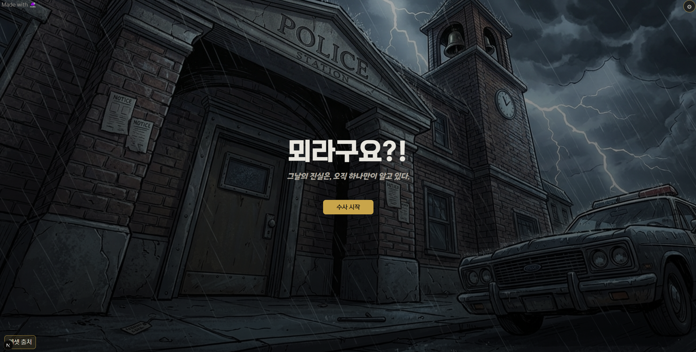
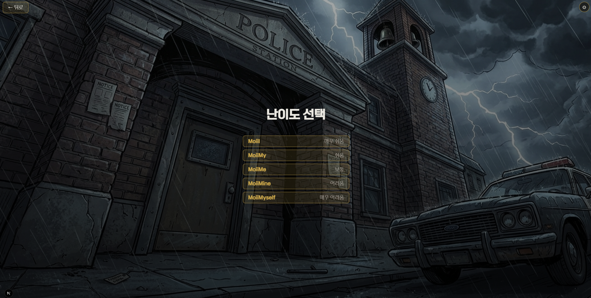
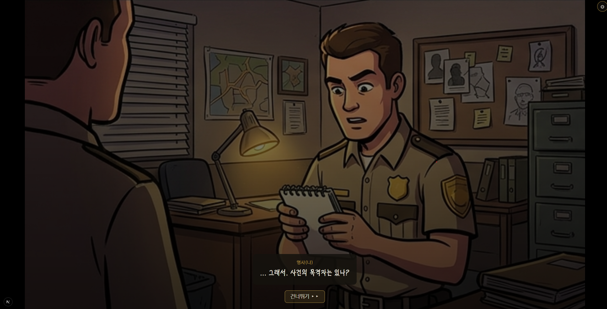
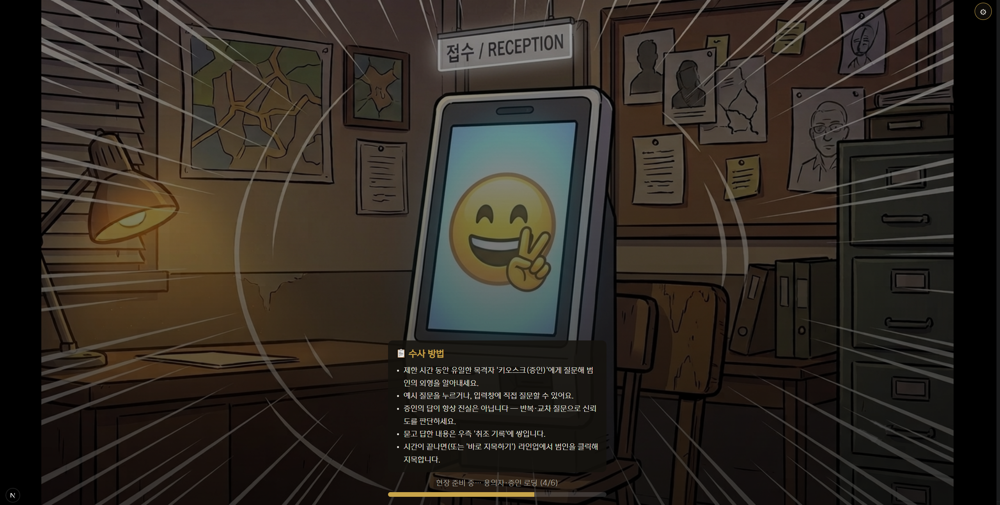

# 뫼라구요?! (MoiiBe?!)

축제의 밤 살인사건. 유일한 목격자인 **키오스크 AI 증인**을 취조해 3D 아바타 라인업에서 범인을 찾는 웹 추리 게임. [Moiime SDK](https://moii.me/) 데모.

   

## 실행 준비 (Windows)

1. [Releases](../../releases)에서 `MoiiBe-<버전>-windows.zip`을 받아 압축 해제
2. [moii.me](https://moii.me/)에서 **API 키(mk_pub_…)**와 **캐릭터**를 만든다
3. 키의 허용 도메인에 **`http://localhost:8700`**를 추가
4. `play.bat` 실행 → 처음 한 번 키와 캐릭터 ID를 물어보고, 브라우저에서 게임이 열린다

입력한 값은 압축을 푼 폴더의 `moiime.config.json`에만 저장된다. 바꾸려면 `reset-keys.bat`. 배포 파일에는 어떤 키도 들어 있지 않다.

## 게임

타이틀 → 난이도 선택 → 프롤로그 → 취조 → 지목 → 결과

- **취조**: 180초 동안 예시 질문을 고르거나 직접 입력해 증인에게 묻는다. AI 증인이 자연어 답변과 음성(TTS)으로 진술
- **지목**: 용의자를 확대 · 회전해 관찰한 뒤 범인을 한 번 지목
- **결과**: 승패 · 범인 공개 · 증언 리뷰
- **난이도 5단계**: 용의자 수(4~6명)와 닮은꼴 용의자의 색 · 파츠 공유 정도, 증언 신뢰도가 달라진다
- 한국어 · 영어, 데스크톱 · 모바일(세로) 레이아웃

---
Made with [Moiime SDK](https://moii.me/)
